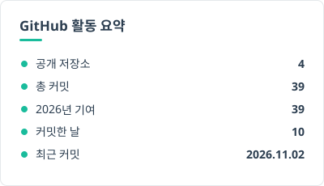
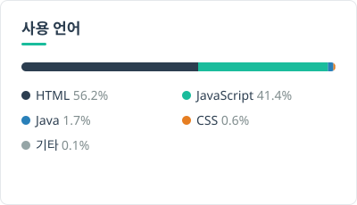
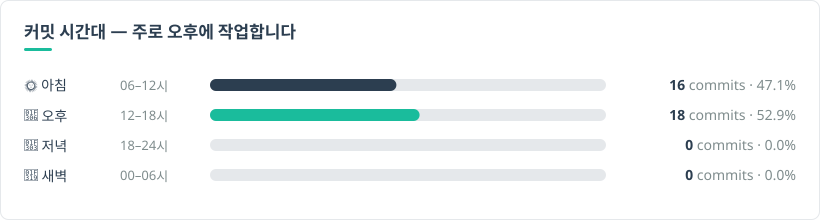

 

### 🧭 Focus

### 🛠 Toolkit

 

### ⚙️ How I Work

| Problem Definition | Scope & Priority | System & Policy | Delivery |
|---|---|---|---|
| 요구사항을 그대로 기능화하지 않고, 문제·목표·영향 범위를 먼저 정의합니다 | 사용자 영향도·운영 효과·개발 리소스를 기준으로 범위와 우선순위를 결정합니다 | 커머스 정책과 예외 케이스를 실제 API·데이터 구조까지 연결해 설계합니다 | 개발·디자인·QA와 함께 배포와 운영까지 End-to-End로 실행합니다 |

🔧 현재 진행 중: **External Commerce Channel Integration** — Google/Meta 채널 연동 정책 설계

 

### 🚀 Selected Projects

----

**🏢 커넥트웨이브 · 메이크샵** &nbsp;2023.07 – 현재 · PM/PO · [프로젝트 저장소](https://github.com/donghoim/Makeshop)

#### 🔍 AI 기반 상품 검색 필터 &nbsp;2024.12 – 2025.07 · PO
3-Layer 정책을 설계하고 예외 케이스 18종을 정의했으며, AI 추천 로직을 기획했습니다.
> 📈 **운영자 설정 공수 70%↓ · 상품 탐색 전환율 28%↑**

#### 🤖 GEO/MCP 기반 AI Commerce 확장 &nbsp;2026.03 – 2026.08 · PM
GEO/MCP 구조를 설계하고, 운영사별 설정 화면을 기획했습니다.
> 📈 **MCP 연동 상품 124,830건 · AI 검색 클릭률 18.4%↑**

#### 🌐 External Commerce Channel Integration (Google) &nbsp;2026.06 – 2026.10 · 진행중
연동 원칙을 세우고 정책·예외 케이스를 설계했습니다. QA 시나리오를 작성하고, 마케팅 채널 통합 IA와 HTML 화면정의서(43개 화면)를 만들었습니다.
> 📈 **데이터 우선 원칙 수립 · 설계 기준과 충돌하는 설계 2건 발견·수정**

#### 📣 Meta 채널 연동 &nbsp;2026.08 – 2026.10
요구사항 정의, 화면 설계, 정책 판단, QA 시나리오 작성(TC 111건)을 맡았고, 기존 연동 상점의 재연동 전환을 설계했습니다.
> 📈 **Shops 관리·Embedded Signup 경계 설정 · 기존 연동을 끊지 않는 메뉴 전환**

#### 🛒 장바구니 할인 영역 추가 &nbsp;2026 · 기획 완료(개발·QA 진행중)
주문서와 같은 할인 산출 기준으로 정책을 설계하고, HTML 화면정의서와 목업을 만들었습니다.
> 📈 **장바구니 단계에서 할인 상세·최대 할인 결제 금액 노출**

#### 🔐 Security & Compliance &nbsp;2023.07 – 2026.02 · 로그인 보안 · 휴면회원 정책 · 사업자 인증
보안·법령 요구를 관리자 기능으로 설계했습니다. 공격 패턴 지표, 보안 메뉴 통합·reCAPTCHA, 휴면 일괄 해제 통제를 기획했습니다.
> 📈 **ISMS 심사 통과 · 3건 모두 배포**

----

**🏢 보드에프엔씨** &nbsp;2021.05 – 2023.01 · PM/기획 · [프로젝트 저장소](https://github.com/donghoim/BoardFNC)

#### 🧵 OneFabric (원단·부자재 B2B 플랫폼) &nbsp;2021.05 – 2023.01 · PM/기획
ERD를 설계하고, SQL을 작성해 데이터 구조를 검증했습니다.
> 📈 **발주 프로세스 100% 디지털화 · 발주 오류율 87%↓**

#### 🏭 FabricMaster ERP &nbsp;2021.05 – 2022.12 · PM/기획
모듈과 DB를 설계하고, SQL 작성과 쿼리 튜닝을 했습니다.
> 📈 **발주-생산 연동 100% · 원가 계산 오류 92%↓**

----

 

### 📊 GitHub Dashboard

GitHub Actions가 매일 00:00(KST)에 공개 저장소 데이터로 갱신합니다.

 

*"예외 케이스의 완성도가 품질을 결정한다."*

